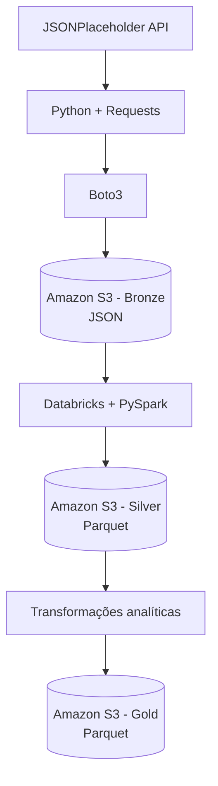

# Projeto de Engenharia de Dados — AWS e Databricks

Pipeline de Engenharia de Dados desenvolvido com Python, AWS S3, Databricks e PySpark, utilizando a arquitetura Medalhão (Bronze, Silver e Gold) para extração, armazenamento, transformação e disponibilização de dados analíticos.

## Sobre o projeto

O objetivo deste projeto é desenvolver um pipeline de Engenharia de Dados utilizando dados da API pública [JSONPlaceholder](https://jsonplaceholder.typicode.com/).

O processo começa com a extração dos dados utilizando Python e Requests. Os dados originais são enviados para o Amazon S3, onde ficam armazenados na camada Bronze.

Em seguida, os dados são processados no Databricks com PySpark, passando pelas camadas Silver e Gold, até serem disponibilizados em formato Parquet para análises.

## Arquitetura

O projeto utiliza a arquitetura Medalhão:

- **Bronze:** armazenamento dos dados originais extraídos da API, em formato JSON.
- **Silver:** limpeza, padronização, seleção de colunas e validação dos dados, com persistência em Parquet.
- **Gold:** criação de tabelas analíticas por meio de agregações com PySpark, também persistidas em Parquet.

### Fluxo de dados



## Tecnologias utilizadas

- **Python:** linguagem utilizada na extração dos dados.
- **Requests:** consumo da API REST.
- **Boto3:** integração com os serviços AWS.
- **Amazon S3:** armazenamento das camadas de dados.
- **AWS IAM / IAM Identity Center:** gerenciamento de acesso aos recursos AWS.
- **AWS CLI:** autenticação e gerenciamento do acesso à AWS.
- **Databricks:** ambiente de processamento distribuído.
- **PySpark:** transformação, agregação e validação dos dados.
- **Apache Parquet:** formato colunar utilizado nas camadas Silver e Gold.
- **Git e GitHub:** versionamento e documentação do projeto.

## Camadas de dados

### Bronze

Os dados são extraídos da API JSONPlaceholder por meio de requisições HTTP utilizando Python e Requests.

Após a extração, o Boto3 realiza o upload dos arquivos JSON para o Amazon S3.

Entidades extraídas:

- Users
- Posts
- Comments

Os dados são armazenados sem transformações, preservando sua estrutura original para possibilitar auditorias e reprocessamentos.

### Silver

O processamento é realizado no Databricks utilizando PySpark.

Nesta etapa são realizadas:

- Seleção e organização das colunas.
- Padronização de textos.
- Conversão de tipos de dados.
- Renomeação de colunas.
- Validação de identificadores.
- Verificação de integridade referencial entre usuários, posts e comentários.

Os dados tratados são persistidos no Amazon S3 em formato Parquet.

### Gold

Na camada Gold são construídas duas tabelas analíticas:

**posts_por_usuario**

- Identificador do usuário.
- Quantidade de posts publicados.

**comentarios_por_post**

- Identificador do post.
- Quantidade de comentários recebidos.

As tabelas são persistidas no Amazon S3 em formato Parquet.

## Estrutura do projeto

```text
Projeto_Pandas/
│
├── notebooks/
│   ├── 01_leitura_bronze_s3.ipynb
│   ├── 02_camada_silver_s3.ipynb
│   └── 03_camada_gold_s3.ipynb
│
├── src/
│   └── raw/
│       └── extract.py
│
├── .env.example
├── .gitignore
├── requirements.txt
└── README.md
```

## Resultados

O pipeline processou os seguintes volumes de dados:

| Entidade | Registros |
| -------- | --------: |
| Users    |        10 |
| Posts    |       100 |
| Comments |       500 |

Resultados das agregações:

- 10 registros na tabela `posts_por_usuario`.
- 100 registros na tabela `comentarios_por_post`.

Os dados foram persistidos no Amazon S3 e recuperados posteriormente para validação da persistência.

## Como executar

### 1. Clonar o repositório

```bash
git clone <URL_DO_REPOSITORIO>
cd Projeto_Pandas
```

### 2. Criar ambiente virtual

```bash
python -m venv .venv
```

Ativar no Windows:

```bash
.venv\Scripts\activate
```

### 3. Instalar dependências

```bash
pip install -r requirements.txt
```

### 4. Configurar variáveis de ambiente

Crie um arquivo `.env` na raiz do projeto:

```env
base_url=https://jsonplaceholder.typicode.com
```

### 5. Configurar autenticação AWS

O projeto utiliza um perfil AWS CLI chamado `projeto-dados`, com autenticação pelo AWS IAM Identity Center.

Após configurar o perfil e as permissões necessárias, autentique-se:

```bash
aws sso login --profile projeto-dados
```

### 6. Executar a extração

Na raiz do projeto:

```bash
python -m src.raw.extract
```

Os arquivos JSON serão enviados para o bucket S3 configurado no código, dentro do prefixo `bronze/`.

### 7. Executar o processamento no Databricks

Os notebooks devem ser importados para um workspace Databricks com acesso configurado ao Amazon S3.

Execute os notebooks na seguinte ordem:

1. `01_leitura_bronze_s3`
2. `02_camada_silver_s3`
3. `03_camada_gold_s3`

## Segurança

- Credenciais AWS não devem ser armazenadas no código ou publicadas no GitHub.
- O arquivo `.env` está incluído no `.gitignore`.
- A autenticação AWS é realizada utilizando AWS IAM Identity Center.
- O acesso ao Amazon S3 é controlado por permissões IAM.

## Considerações finais

Este projeto demonstra a construção de um pipeline de Engenharia de Dados em nuvem, desde a ingestão de dados de uma API externa até a disponibilização de dados transformados e agregados em uma arquitetura Medalhão.

O desenvolvimento permitiu aplicar conceitos de ingestão, armazenamento em Data Lake, processamento distribuído, qualidade de dados, persistência em Parquet e integração entre serviços AWS e Databricks.
